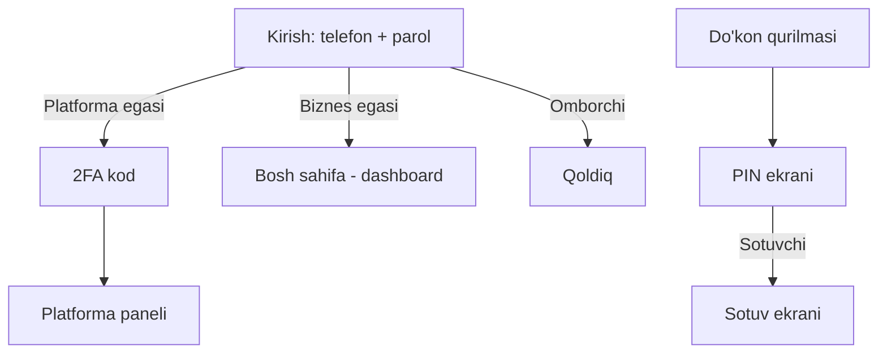
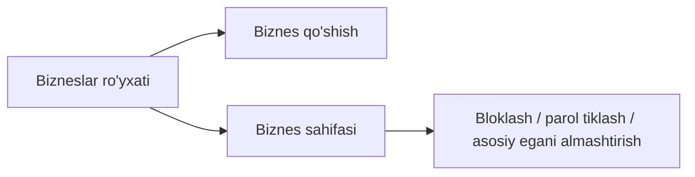
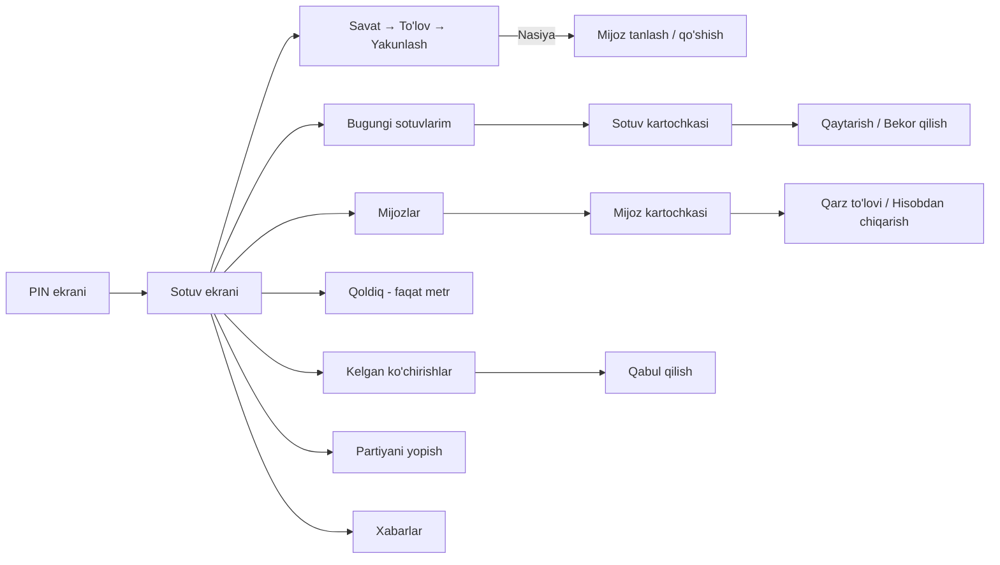
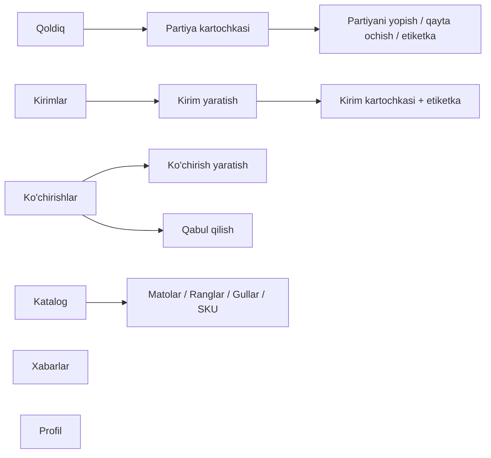

# Sahifalar xaritasi

## Kirish nuqtalari

## Platforma egasi

## Sotuvchi (do'kon qurilmasi)

## Omborchi

## Biznes egasi (asosiy ega va sherik-egalar)
Menyu:

| Bo'lim | Sahifalar |
|--------|-----------|
| Bosh sahifa | Dashboard |
| Sotuv | Sotuv ekrani, Sotuvlar ro'yxati → Sotuv kartochkasi → Qaytarish / Bekor qilish |
| Nasiya | Mijozlar → Mijoz kartochkasi → Qarz to'lovi / Hisobdan chiqarish |
| Ombor | Qoldiq → Partiya kartochkasi; Kirimlar; Ko'chirishlar; Kamomadlar |
| Katalog | Matolar, Ranglar, Gullar, SKU (ommaviy narx) |
| Hisobotlar | Savdo-tushum-foyda, Soatlar, Top tovarlar, Qoldiq, Nasiyalar, Kamomadlar, Narx og'ishi |
| Tuzilma | Do'konlar, Skladlar, Xodimlar, Qurilmalar |
| Sozlamalar | Biznes sozlamalari, Jurnal |
| Yuqori panel | Xabarlar, Profil, Til |

## Yangi aniqlangan sahifalar
Xarita tuzish paytida 3-bosqich hujjatlarida yo'q, lekin kerakli sahifalar topildi:
- **Sotuvlar ro'yxati** (biznes egasi) — barcha sotuvlar, filtrlar bilan; hozir faqat sotuvchining "bugungi sotuvlarim" bor edi → 06-sotuv
- **Sotuv kartochkasi** — bitta sotuvning qatorlari, to'lovi, qaytarishlari → 06-sotuv
- **Partiya kartochkasi** — partiyaning butun tarixi: kirim, ko'chirishlar, sotuvlar, yopilishlar → 05-ombor

## Asosiy ish nechta bosishda
| Rol | Asosiy ish | Yo'l |
|-----|-----------|------|
| Sotuvchi | Sotish | PIN → sotuv ekrani (darhol) |
| Sotuvchi | Ko'chirishni qabul qilish | xabar → qabul qilish |
| Omborchi | Kirim | Kirimlar → Kirim yaratish |
| Biznes egasi | Kunlik natija | kirish → dashboard (darhol) |
