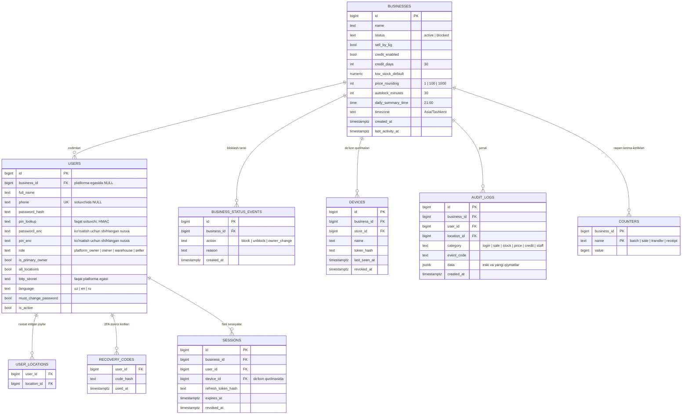
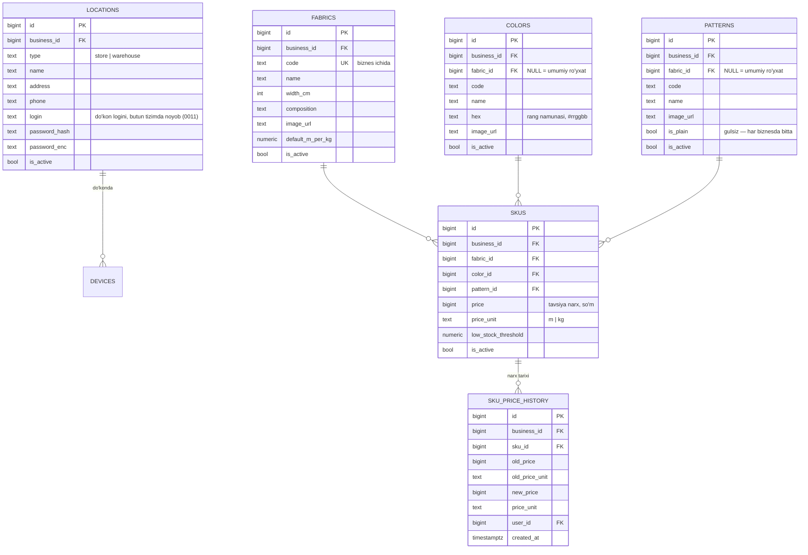
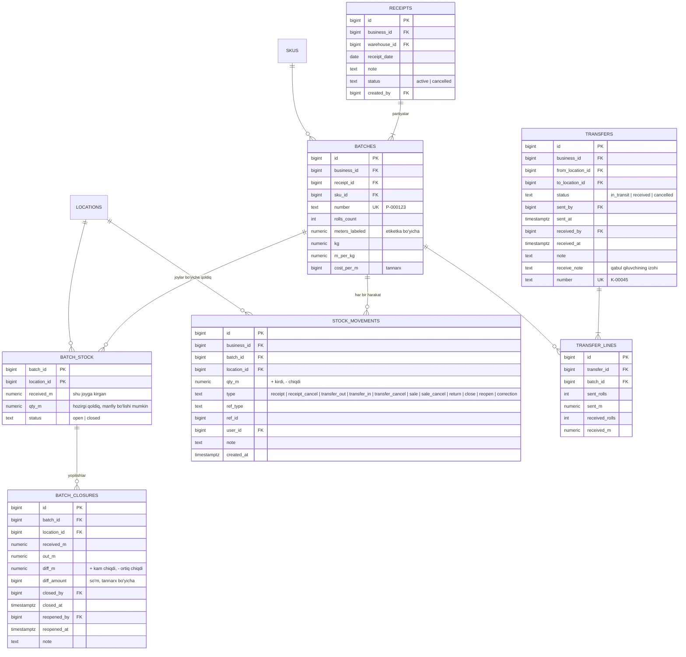
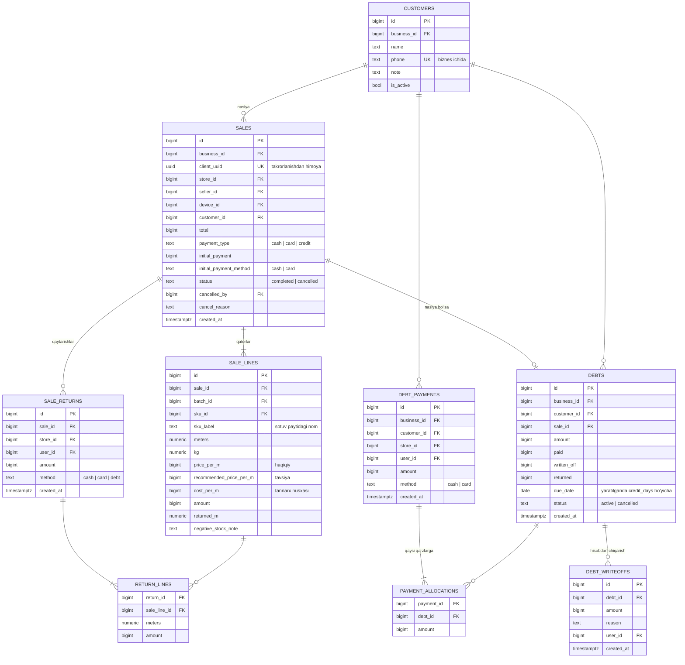
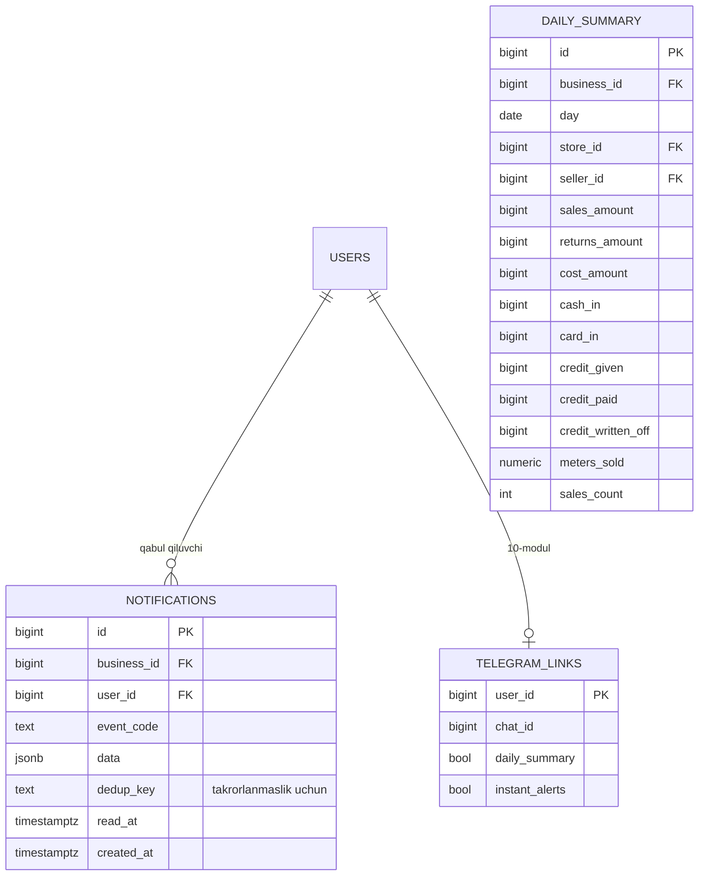

# Baza sxemasi

PostgreSQL. Jadval va ustun nomlari inglizcha. Biznesga tegishli har jadvalda `business_id` + Row-Level Security.

## Turlar
| Ma'lumot | Tur | Sabab |
|----------|-----|-------|
| Pul (so'm) | `bigint` | butun son, yaxlitlash xatosi yo'q |
| Metr | `numeric(12,2)` | 1 sm aniqlik |
| Kg | `numeric(12,3)` | 1 g aniqlik |
| Koeffitsient (1 kg = X m) | `numeric(10,4)` | — |
| Vaqt | `timestamptz` | UTC'da saqlanadi, Asia/Tashkent'da ko'rsatiladi |
| Id | `bigint` (identity) | — |

## 1. Platforma va kirish (00-core, 01-platform-admin)

- Platforma egasi `users` jadvalida, `business_id = NULL`, `role = platform_owner`.
- PIN faqat faol sotuvchilar orasida noyob — qisman noyob indeks: `(business_id, pin_lookup) WHERE role='seller' AND is_active`.
- `audit_logs` faqat qo'shiladi; yangilash va o'chirish trigger bilan taqiqlanadi (ilova bitta baza foydalanuvchisi bilan ishlagani uchun ruxsatlar yetarli emas).
- `sessions` — xodim faolsizlantirilganda yoki qurilma uzilganda **darhol** chiqarish uchun: har sessiya bazada, tekshirilganda `revoked_at` ko'riladi. Busiz JWT muddati tugaguncha xodim ishlayveradi.
- `counters` — P-000123, S-000045, K-00045 kabi raqamlar har biznes uchun alohida va uzluksiz; qator qulflanib oshiriladi (ketma-ketlikda bo'shliq qolmaydi).
- `users.phone` — qisman noyob indeks `WHERE phone IS NOT NULL`.

## 2. Tuzilma va katalog (02-structure, 03-catalog)

- Do'kon va sklad interfeysda alohida, bazada bitta `locations` jadvali (`type` bilan) — qoldiq, ko'chirish va yopish ikkalasida bir xil ishlaydi.
- `colors.fabric_id` va `patterns.fabric_id` NULL bo'lsa — umumiy ro'yxat; to'ldirilsa — faqat shu matoniki. Biznes savoliga (ranglar umumiymi yoki matoniki) qanday javob kelsa ham sxema o'zgarmaydi.
- "Gulsiz" — oddiy `patterns` yozuvi, har biznesga avtomatik yaratiladi.
- SKU noyob: `(business_id, fabric_id, color_id, pattern_id)`.
- Rang/gul kodi noyob: `(business_id, fabric_id, code)` — `fabric_id` NULL bo'lganda ham ishlashi uchun `UNIQUE NULLS NOT DISTINCT` (PostgreSQL 15+).

## 3. Kirim va ombor (04-receiving, 05-inventory) — tizimning yuragi

- **Ikki qatlam:** `stock_movements` — hech qachon o'zgarmaydigan harakatlar jurnali (haqiqat manbai, partiya kartochkasidagi tarix shundan). `batch_stock` — hozirgi qoldiq; har harakat bilan **bitta tranzaksiyada** yangilanadi. Sotuvda faqat shu bitta qator qulflanadi (`SELECT ... FOR UPDATE`) — boshqa partiya va do'konlar kutmaydi.
- Tekshiruv: `batch_stock.qty_m` = shu partiya-joy bo'yicha `stock_movements.qty_m` yig'indisi. Kechasi avtomatik solishtiriladi; farq chiqsa — platforma egasiga xabar.
- Yo'ldagi tovar: `transfer_out` jo'natuvchidan ayiradi, `transfer_in` qabulda qo'shadi; oraliqda metr `transfer_lines` da turadi.
- Partiya yopilganda `close` harakati qoldiqni 0 ga keltiradi, farq `batch_closures` ga yoziladi. Qayta ochishda `reopen` buni bekor qiladi.
- **Ko'chirishda yo'qolgan metr** (jo'natilgan 500, qabul qilingan 488) joylar qoldig'iga kirmaydi — faqat `transfer_lines` da turadi va "Metr farqi" hisobotida alohida qatorda ko'rinadi. Shunda u partiya yopilganda ikkinchi marta hisoblanmaydi.
- **Qoldiqni faqat bitta funksiya o'zgartiradi** (`inventory.service.move_stock`): u `stock_movements` ga yozadi va `batch_stock` ni bitta tranzaksiyada yangilaydi. Boshqa hech qayerda `batch_stock` to'g'ridan-to'g'ri o'zgartirilmaydi.
- **Kam qoldiq tekshiruvi** sotuvdan keyin fonda: SKU-joy bo'yicha `batch_stock` yig'indisi chegara bilan solishtiriladi (indeks: `batch_stock (location_id, batch_id)` + `batches (sku_id)`). Alohida kesh jadvali kerak emas.

## 4. Sotuv va nasiya (06-sales, 07-credit)

- **Sotuv qatorida nusxalar:** nom, tavsiya narx va tannarx sotuv paytidagi qiymat bilan saqlanadi. Keyin katalogda narx yoki nom o'zgarsa ham eski sotuvlar, foyda va narx og'ishi hisoboti buzilmaydi.
- **Qarz har sotuvdan alohida** (`debts`). Qolgan qarz = amount − paid − written_off − returned. `due_date` qarz yaratilganda hisoblanadi — keyin biznes `credit_days` ni o'zgartirsa, eski qarzlar siljimaydi. Sotuv bekor qilinsa qarz `cancelled`.
- **To'lov taqsimoti** (`payment_allocations`): bitta to'lov bir nechta eski qarzni yopishi mumkin; har biriga qancha tushgani saqlanadi.
- `client_uuid` — sotuv ekrani yaratadi; server bir xil uuid'ni ikki marta qabul qilmaydi.

## 5. Xabarlar va hisobotlar (09-notifications, 08-reports, 10-telegram)

- `daily_summary` — noyob `(business_id, day, store_id, seller_id)`; har sotuv, qaytarish va to'lovda shu kun qatori yangilanadi (`INSERT ... ON CONFLICT DO UPDATE`). Haqiqiy jadvallardan qayta hisoblab chiqadigan buyruq bo'ladi. Hisobotlar va dashboard katta jadvallarni emas, shuni o'qiydi — oylar o'tsa ham tez.
- Soatlik trend va top tovarlar `sale_lines` dan indekslar bilan olinadi.
- `notifications.dedup_key` — masalan kam qoldiq xabari bir SKU-joy uchun qayta to'ldirilguncha bir marta.

## Row-Level Security (RLS)
- **Har jadvalda `business_id`** — bog'liq jadvallarda ham (`sale_lines`, `transfer_lines`, `return_lines`, `payment_allocations`, `batch_stock`, `batch_closures`, `sku_price_history`, `user_locations`, `sessions`). Shunda RLS siyosati hamma joyda bir xil: `business_id = current_setting('app.business_id')::bigint`.
- Har so'rov boshida `SET LOCAL app.business_id = ...` (tranzaksiya ichida — ulanishlar puli bilan xavfsiz).
- Platforma egasi uchun RLS'siz alohida baza roli; u biznes ma'lumotlariga kirmaydi (01-modul).
- Ilova kodi `business_id` ni unutsa ham baza boshqa biznes ma'lumotini qaytarmaydi — bu ikkinchi himoya qatlami.

## Indekslar (asosiylari)
- Har jadvalda `business_id` bilan boshlanadigan indekslar
- `sales (business_id, created_at)`, `sales (business_id, store_id, created_at)`
- `sale_lines (sku_id)`, `sale_lines (batch_id)`
- `stock_movements (batch_id, location_id, created_at)`
- `debts (business_id, customer_id) WHERE` qolgan qarz > 0
- `batches (business_id, number)`
- `batch_stock (location_id, batch_id)`, `notifications (user_id) WHERE read_at IS NULL`, `sessions (user_id) WHERE revoked_at IS NULL`
- `audit_logs` va `stock_movements` — oy bo'yicha bo'laklash (partitioning) hajm oshganda; hozir kerak emas

## Biznes savollariga bog'liqlik
| Savol | Sxemada |
|-------|---------|
| Partiya bir nechta joyda bo'ladimi | `batch_stock` (partiya, joy) — ha ham, yo'q ham ishlaydi |
| Ranglar umumiymi yoki matoniki | `fabric_id` NULL yoki to'ldirilgan — ikkalasi |
| Rang/gul rasmi | `image_url` ixtiyoriy |
| Kirimda bir nechta partiya | `receipts` → `batches` — ikkalasi |
| Etiketka o'lchami | bazaga ta'sir qilmaydi |

## 2-ko'rib chiqish (2026-10-02) — nima o'zgardi
1. `sessions` jadvali — xodimni va qurilmani darhol chiqarish uchun (busiz JWT muddati tugaguncha ishlayverardi).
2. `counters` — har biznes uchun uzluksiz hujjat raqamlari.
3. Har jadvalda `business_id` — RLS hamma joyda bir xil ishlashi uchun.
4. `debts.due_date` va `debts.status` — muddat qotirib qo'yiladi, bekor qilingan sotuv qarzi ajratiladi.
5. `businesses.timezone` — kelajakda boshqa mamlakatlar uchun, hozir Asia/Tashkent.
6. `stock_movements.type` ga `receipt_cancel`; `batch_closures.note`.
7. `daily_summary` — surrogat PK + noyob indeks (`seller_id` NULL bo'lishi mumkin).
8. Ko'chirishda yo'qolgan metr qayerda turishi aniq yozildi — ikki marta hisoblanmaydi.
9. Rang/gul kodi noyobligi `NULLS NOT DISTINCT` bilan.
10. Qoldiqni o'zgartirish faqat bitta funksiya orqali — qoida.

## 3-ko'rib chiqish (2026-10-02, 1-migratsiya yozilganda) — nima aniqlashdi
1. **Ikki baza roli.** PostgreSQL'da jadval egasi va superuser RLS'ni chetlab o'tadi, shuning uchun ilova alohida `mato_app` roli bilan ulanadi (RLS ta'sir qiladi). Jadvallar egasi faqat migratsiyalar, kirishdagi qidiruv (telefon, qurilma, sessiya bo'yicha — biznes hali noma'lum) va platforma paneli uchun. `business_status_events` va `recovery_codes` ga ilova rolining umuman huquqi yo'q.
2. **`users.pin_hash` → `pin_lookup`.** Do'kon qurilmasida sotuvchi faqat PIN bilan kiradi, ya'ni tizim uni PIN bo'yicha topishi va noyoblikni tekshirishi kerak. Har safar boshqacha chiqadigan bcrypt bilan bu mumkin emas — shuning uchun HMAC(SECRET_KEY, PIN). Noyob indeks: `(business_id, pin_lookup) WHERE role='seller' AND is_active`.
3. **Ilova roli hech narsa o'chira olmaydi** (DELETE huquqi yo'q; yagona istisno — `user_locations`). `businesses` da faqat sozlama ustunlarini yangilaydi: holat (`status`) va nom unga yopiq — bloklangan biznes o'zini blokdan chiqara olmaydi.
4. **`audit_logs`**: ilova roli faqat qo'shadi va o'qiydi; yangilash, o'chirish va TRUNCATE trigger bilan hammaga (jadval egasiga ham) taqiqlangan.
5. **Qo'shilgan ustun va cheklovlar:** `created_at` (`users`, `locations`, `devices`, `sessions`); `business_status_events.user_id` (bloklash tarixida "kim"); `recovery_codes.id`; `users` da — har biznesda bitta asosiy ega (noyob indeks) va "platforma egasi ⇔ `business_id` NULL" tekshiruvi.
6. **`locations` 1-migratsiyada** yaratildi (02-structure dan oldin), chunki `devices`, `user_locations` va `audit_logs` unga bog'lanadi. Nom noyobligi indeksi 02-structure da qo'shiladi.
7. Joriy biznes `set_config('app.business_id', ..., true)` bilan o'rnatiladi (`SET LOCAL` parametr qabul qilmaydi); o'rnatilmagan bo'lsa siyosat hech qaysi qatorni ko'rsatmaydi.

## 4-ko'rib chiqish (2026-10-02, 03-catalog — 3-migratsiya) — nima aniqlashdi
1. **Kodlar katta-kichik harfni farqlamaydi.** Noyoblik `lower(code)` bo'yicha: `fabrics (business_id, lower(code))`, `colors` va `patterns` da `(business_id, fabric_id, lower(code)) NULLS NOT DISTINCT`. "M101" va "m101" — bitta kod.
2. **`colors.hex`** — rang namunasi (`#rrggbb`, kichik harfda; tekshiruv bazada). Rasm o'rniga yoki u bilan birga: ro'yxatlarda va sotuvda rangni tez topish uchun.
3. **`patterns.is_plain`** — "gulsiz" yozuvi. Har biznesda bittadan (qisman noyob indeks `(business_id) WHERE is_plain`), birinchi murojaatda o'zi yaratiladi, faolsizlantirilmaydi. SKU kodida ko'rsatilmaydi: `M101-03` (gulsiz), `M101-03-G1` (gulli).
4. **`sku_price_history.old_price_unit`** — narx birligi ham o'zgarishi mumkin (so'm/m → so'm/kg), tarixda "eski → yangi" to'liq ko'rinishi uchun. `business_id` ham bor (RLS).
5. **`skus`:** `price` bo'sh bo'lishi mumkin ("narxi belgilanmagan"), `price_unit` standart `m`; tekshiruvlar: `price > 0`, `low_stock_threshold > 0`. `created_at` — to'rttala jadvalda.
6. **`colors.fabric_id` / `patterns.fabric_id`** sxemada qoldi, lekin 1-versiyada doim bo'sh — ro'yxat barcha matolar uchun umumiy (biznesdan-savollar, 2-savol). Javob "har matoniki" bo'lsa, sxema o'zgarmaydi — faqat interfeys.
7. **`image_url`** — faqat shu biznes yuklagan rasm manzili (`/api/media/<biznes>/<fayl>.webp`); tashqi havola qabul qilinmaydi. Fayllar bazada emas, diskda (`MEDIA_DIR`).
8. Huquqlar: `fabrics`, `colors`, `patterns`, `skus` — SELECT, INSERT, UPDATE; `sku_price_history` — faqat SELECT, INSERT (tarix o'zgartirilmaydi).

## 5-ko'rib chiqish (2026-10-02, 04-receiving — 4-migratsiya) — nima aniqlashdi
1. **`batch_stock` va `stock_movements` 4-migratsiyada** yaratildi (05-inventory dan oldin), chunki kirim skladga qoldiq tushiradi. Ko'chirish va yopish jadvallari (`transfers`, `transfer_lines`, `batch_closures`) 05-modulda qo'shiladi.
2. **`stock_movements` o'zgarmas:** ilova roli faqat qo'shadi va o'qiydi; yangilash, o'chirish va TRUNCATE trigger bilan hammaga taqiqlangan (`audit_logs` kabi). Xato harakat o'chirilmaydi — teskari harakat bilan tuzatiladi (`correction`, `receipt_cancel`).
3. **`receipts`:** qo'shildi — `number` (`KR-00045`, biznes ichida noyob; `K-` — ko'chirish raqamlari uchun, eskizdagidek), `cancelled_by`, `cancelled_at`, `created_at`.
4. **`batches`:** `number` biznes ichida noyob; tekshiruvlar bazada — `rolls_count >= 1`, `meters_labeled > 0`, `kg > 0`, `m_per_kg > 0`, `cost_per_m >= 0`; `created_at`.
5. **`batch_stock.business_id`** (RLS uchun); `received_m` va `qty_m` standart 0. Qatorni faqat `move_stock` yaratadi va o'zgartiradi — `SELECT ... FOR UPDATE` bilan qulflab.
6. **Raqamlar** `counters` jadvalidan bitta `INSERT ... ON CONFLICT DO UPDATE ... RETURNING` bilan olinadi — qator qulflanadi, bir vaqtdagi so'rovlar navbat bilan o'tadi.
7. Aniqlik: metr `numeric(12,2)`, kg `numeric(12,3)`, koeffitsient `numeric(10,4)` (metr ÷ kg yarim yuqoriga yaxlitlanadi), summa — butun so'm.

## 6-ko'rib chiqish (2026-10-02, 05-inventory — 5-migratsiya) — nima aniqlashdi
1. **`transfers`:** qo'shildi — `number` (`K-00045`, biznes ichida noyob), `receive_note` (qabul qiluvchining izohi), `cancelled_by`, `cancelled_at`; tekshiruv — jo'natuvchi va qabul qiluvchi joy bir xil bo'lmaydi.
2. **`transfer_lines.diff_note` olib tashlandi** — izoh qatorda emas, butun ko'chirish uchun bitta (`transfers.receive_note`), tasdiqlangan eskizdagidek. `business_id` qo'shildi (RLS); bitta ko'chirishda partiya bir marta (`UNIQUE (transfer_id, batch_id)`).
3. **`batch_closures`:** `business_id` (RLS), `diff_amount` ishorali (kam chiqdi — musbat, ortiq chiqdi — manfiy). Qayta ochilganda yozuv o'chirilmaydi — `reopened_by`, `reopened_at` to'ldiriladi va hisobotga kirmaydi.
4. **`batch_stock.status`** ni ham faqat `move_stock` o'zgartiradi (yopish, qayta ochish, yopilgan joyga ko'chirish kelganda avtomatik ochilish).
5. Ko'chirish va yopish harakatlari `stock_movements.ref_type` = `transfer` / `closure` bilan hujjatga bog'lanadi — partiya tarixida havola shundan.
6. Huquqlar: uchala jadval — SELECT, INSERT, UPDATE (DELETE yo'q).

## 7-ko'rib chiqish (2026-10-02, 09-notifications — 6-migratsiya) — nima aniqlashdi
1. **`notifications`** sxemadagidek; noyoblik — `(user_id, dedup_key) WHERE dedup_key IS NOT NULL`: bir xodimga bir hodisa bo'yicha bitta xabar. Hodisa tugasa (tovar to'ldirildi) kalit bo'shatiladi (`dedup_key = NULL`) — keyingi safar yangi xabar yoziladi.
2. Indekslar: `(user_id, created_at)` — ro'yxat; `(user_id) WHERE read_at IS NULL` — o'qilmaganlar soni.
3. RLS biznes bo'yicha; "faqat o'z xabari" — servisda (`user_id = joriy xodim`). Huquqlar: SELECT, INSERT, UPDATE.
4. `daily_summary` va `telegram_links` jadvallari o'z modullarida (08-reports, 10-telegram) yaratiladi.

## 8-ko'rib chiqish (2026-10-02, 06-sales — 7-migratsiya) — nima aniqlashdi
1. **`customers` va `debts` 7-migratsiyada** yaratildi (07-credit dan oldin) — nasiya sotuv mijoz va qarzsiz yozilmaydi. `debt_payments`, `payment_allocations`, `debt_writeoffs` 07-modulda qo'shiladi.
2. **`sales`:** qo'shildi — `number` (`S-000045`, biznes ichida noyob), `returned_total` (qaytarilgan tovar summasi — ro'yxat va holat uchun), `cancelled_at`. `client_uuid` noyobligi biznes ichida. `device_id` bo'sh bo'lishi mumkin (biznes egasi qurilmasiz sotganda).
3. **Sotuv holati** bazada ikki xil — `completed` / `cancelled`. "Qisman qaytarilgan" va "qaytarilgan" alohida saqlanmaydi: `returned_total` dan hisoblanadi.
4. **`sale_returns.method`** faqat `cash` / `card` yoki bo'sh; sxemadagi `debt` qiymati o'rniga **`debt_amount`** ustuni. Sabab: bitta qaytarishning bir qismi qarzdan ayrilib, qolgani pul bilan qaytishi mumkin (mijoz boshlang'ich to'lov qilgan bo'lsa). Pul bilan qaytgani = `amount − debt_amount`.
5. **`sale_lines`, `sale_returns`, `return_lines`** da `business_id` (RLS). `return_lines.id` qo'shildi. Tekshiruvlar bazada: `meters > 0`, `price_per_m > 0`, `0 <= returned_m <= meters`, `debt_amount <= amount`.
6. **`debts`:** har sotuvga bitta qarz (`UNIQUE (sale_id)`); tekshiruv — `paid + written_off + returned <= amount`. Indekslar: `(business_id, customer_id)`, `(business_id, due_date)` — muddati o'tganlar uchun.
7. **`customers.phone`** `+998XXXXXXXXX` ko'rinishida saqlanadi, biznes ichida noyob; `created_at` qo'shildi.
8. Sotuv harakatlari `stock_movements.ref_type = 'sale'` bilan sotuvga bog'lanadi (`sale`, `sale_cancel`, `return`) — partiya tarixida sotuv raqami shundan. Qoldiqdan ko'p sotishdagi izoh harakatning `note` ida ham bor.
9. Huquqlar: `customers`, `debts`, `sales`, `sale_lines` — SELECT, INSERT, UPDATE; `sale_returns`, `return_lines` — faqat SELECT, INSERT (qaytarish yozuvi o'zgartirilmaydi).

## 9-ko'rib chiqish (2026-10-02, 07-credit — 8-migratsiya) — nima aniqlashdi
1. **`debt_payments.store_id` majburiy.** Sotuvchida — qurilma bog'langan do'kon; ega qurilmasiz qabul qilsa — yopilayotgan eng eski qarz berilgan do'kon. Tushum hisobotida (08) har to'lov biror do'konga tegishli bo'ladi.
2. **`payment_allocations`:** `id` va `business_id` (RLS) qo'shildi; bitta to'lovda qarz bir marta (`UNIQUE (payment_id, debt_id)`); `amount > 0`.
3. **`debt_writeoffs`:** `business_id` (RLS); `amount > 0`; sabab bo'sh bo'lmaydi (servisda tekshiriladi).
4. **Uchala jadval faqat qo'shiladi:** ilova rolida SELECT va INSERT bor, UPDATE va DELETE yo'q — pul yozuvi tuzatilmaydi. Qarzning joriy holati `debts.paid / written_off / returned` da; ular faqat qator qulflangan holda o'zgartiriladi (`SELECT ... FOR UPDATE`).
5. Indekslar: `debt_payments (business_id, customer_id)` — mijoz tarixi, `(business_id, created_at)` — tushum hisoboti; `payment_allocations (debt_id)`; `debt_writeoffs (debt_id)`, `(business_id, created_at)`.
6. "Muddati o'tgan qarz" xabari uchun alohida jadval yo'q — `notifications.dedup_key = debt_overdue:<qarz>`.

## 10-ko'rib chiqish (2026-10-02, 08-reports) — nima aniqlashdi
1. **`daily_summary` jadvali yaratilmadi.** Hisobotlar va dashboard asl jadvallardan (`sales`, `sale_lines`, `sale_returns`, `return_lines`, `debt_payments`, `debts`, `batch_stock`) to'g'ridan-to'g'ri hisoblanadi. Sabab: yig'ma jadvalni har sotuv, qaytarish, bekor qilish, to'lov va hisobdan chiqarishda bexato yangilab turish murakkab, pilot hajmida esa to'g'ridan-to'g'ri hisoblash yetarli tez va har doim aniq. Hajm oshsa — shu jadval (yoki materiallashtirilgan ko'rinish) qo'shiladi; hisob-kitob bitta joyda (`reports/service.py`).
2. Hisobotlar tayanadigan indekslar oldingi migratsiyalarda bor: `sales (business_id, created_at)`, `(business_id, store_id, created_at)`; `sale_lines (sale_id)`, `(sku_id)`; `sale_returns (business_id, created_at)`; `debt_payments (business_id, created_at)`; `debts (business_id, due_date)`.
3. Kunlar biznes vaqt mintaqasida guruhlanadi: `timezone('<mintaqa>', created_at)::date`.
4. Yangi migratsiya yo'q.

## 11-ko'rib chiqish (2026-10-02, 10-telegram — 9-migratsiya) — nima aniqlashdi
1. **`telegram_links`:** qo'shildi — `business_id` (RLS), `username` (qaysi akkaunt ulanganini ko'rsatish uchun), `linked_at`. `chat_id` bo'sh bo'lishi mumkin: uzilganda qator o'chirilmaydi (ilova rolida DELETE yo'q), sozlamalar saqlanib qoladi.
2. Ulash havolasi (bir martalik token), bot yangiliklari o'rni (`offset`) va "bugun xulosa yuborildi" belgisi bazada emas — Redis'da (vaqtinchalik ma'lumot).
3. Kunlik xulosa vaqti — mavjud `businesses.daily_summary_time` (1-migratsiya); API orqali faqat to'liq soat qabul qilinadi.
4. Huquqlar: `telegram_links` — SELECT, INSERT, UPDATE.
5. Sxemadagi 32 jadvaldan qurilmagani bitta: `daily_summary` (10-ko'rib chiqish).

## 12-ko'rib chiqish (2026-10-03, audit — 13-migratsiya) — nima aniqlashdi
1. **Takrorlanishdan himoya uch jadvalga kengaydi:** `debt_payments.client_uuid`, `receipts.client_uuid`, `transfers.client_uuid` (uuid, bo'sh bo'lishi mumkin) + `UNIQUE (business_id, client_uuid)` — `sales.client_uuid` naqshi (7-migratsiya). Bo'sh qiymat — 13-migratsiyagacha yozilgan qatorlar (NULL'lar noyoblikni buzmaydi); API orqali kelgan har yangi yozuvda maydon majburiy.
2. Server xulqi to'rt amalda bir xil (sotuv, qarz to'lovi, kirim, ko'chirish): identifikator qayta kelsa — avvalgi yozuv (HTTP 200); mazmuni farq qilsa — 409 (`sale_basket_changed` / `request_changed`). Solishtirish saqlangan qatorlardan: sotuv — do'kon, qatorlar (partiya, metr, narx), to'lov turi, mijoz, boshlang'ich to'lov; to'lov — mijoz, summa, to'lov turi; kirim — sklad, sana, qatorlar (mato, rang, gul, rulon, metr, tannarx); ko'chirish — qayerdan, qayerga, qatorlar (partiya, rulon, metr).
3. Bir vaqtda kelgan takrorlar: yozuv va uning raqami bitta "saqlash nuqtasi" (savepoint) ichida — noyoblik buzilsa raqam ham qaytadi (raqamlarda bo'shliq qolmaydi). To'lovda mijozning qarz qatorlari qulflangach tekshiriladi.
4. RLS va huquqlar o'zgarmadi (jadval darajasida berilgan: `receipts`, `transfers` — SELECT, INSERT, UPDATE; `debt_payments` — SELECT, INSERT). Noyoblik biznes ichida — boshqa biznes shu identifikatorni ishlata oladi (test bilan tekshirilgan).
5. **`sessions`:** sxema o'zgarmadi. Uzoq muddatli token har yangilashda almashadi — `refresh_token_hash` yangilanadi; almashtirilgan token 60 soniya davomida o'rnidagi yangisiga yo'llaydi (Redis'da, shifrlangan) — bir vaqtda yangilayotgan oynalar bitta tokenni oladi.
6. PIN bloki hisoblagichlari (do'kon bo'yicha "nechanchi blok") — Redis'da, bazada emas.
