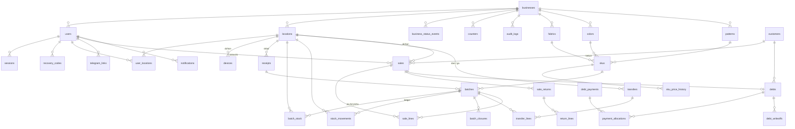

# Loyiha xaritasi

**Loyiha:** mato-savdo — mato sotuvchilar uchun multi-tenant SaaS: sklad (partiyalar), ko'chirish, sotuv, nasiya, hisobotlar, Telegram xabarlari. Web + PWA, uz/en/ru.
**Audit sanasi:** 2026-10-14 · **Oxirgi commit:** 2026-10-05, Sunnatbek Samandarov (`78d93ff`), branch `audit-va-ui-zichligi`; ustida 45 faylda commit qilinmagan ish (+2109 / −360 qator, oxirgi tahrir 2026-10-12)
**Holat:** barcha 11 modul kodda tugallangan; ishlab chiqarishga chiqmagan (lokal prod mashqi o'tkazilgan, haqiqiy VPS yo'q) · **Foydalanuvchilar:** hozircha yo'q, pilot kutilmoqda

## Stek
- **Backend:** Python 3.13 · FastAPI 0.142 · SQLAlchemy 2.1 (async, asyncpg 0.31) · Alembic 1.20 · Pydantic 2.13 · arq 0.28 (Redis navbati) · bcrypt 5 · pyjwt · cryptography 50 · pyotp · openpyxl · Pillow 12 · httpx
- **Baza:** PostgreSQL 16 (Docker), Row-Level Security; uch rol: `mato_app` (RLS), `mato_system` (RLS'siz, DDL/DELETE'siz), `mato` (egasi, faqat migratsiya) · Redis 7
- **Frontend:** React 18.3 · TypeScript 5.9 · Vite 5.4 · vite-plugin-pwa 0.20 · React Router 6.30 · TanStack Query 5 · i18next 23 · Tailwind 3.4 · @zxing (kamera skaneri) · Three.js 0.186 + R3F 8 (faqat kirish sahifasidagi 3D) · Vitest 2 · ESLint 9
- **Infra:** Docker Compose (dev: db+redis; prod: db, redis, backend, worker, Caddy, backup, restore-profil) · Caddy (HTTPS, CSP, SPA) · `age` + `rclone` (shifrlangan kunlik zaxira) · `dev.sh` (lokal serverlar), Cloudflare tunnel (telefon sinovi)
- **Eskirgan / katta versiya kutayotganlar:** `react-router-dom` 6.x → 7.x (npm audit: 2 ta o'rtacha CVE, faqat 7.x da tuzatilgan), vite 5 → 8, vitest 2 → 5, tailwind 3 → 4, i18next 23 → 26, R3F 8 → 9, drei 9 → 10, React 18 → 19. Backend kutubxonalari yangi (pip-audit o'rnatilmagan — tekshirilmadi).

## Tuzilma
| Papka | Vazifasi | Izoh |
|-------|----------|------|
| `backend/app/core/` | config, db (ikki engine, `tenant_session`/`system_session`), deps (auth), rls, security (JWT, bcrypt), vault (parol shifrlash), audit, counters (hujjat raqamlari), queue, redis, ratelimit, media, alerts, errors | 20 fayl |
| `backend/app/modules/<name>/` | auth, platform, structure, catalog, receiving, inventory, notifications, sales, credit, reports, telegram — har birida models/schemas/service/router (+permissions) | 88 .py, 13 244 qator; 135 endpoint |
| `backend/app/worker.py` | arq fon vazifalari: 24 soatlik ko'chirish eslatmasi, muddati o'tgan qarz, bo'sh partiya eslatmasi, sessiya tozalash, kechki solishtiruv, Telegram (darhol + kunlik xulosa) | 292 qator |
| `backend/app/manage.py` | boshqaruv buyruqlari (`create-platform-owner` va b.) | |
| `backend/alembic/versions/` | 16 migratsiya (0001_core … 0016_sku_image); `0016` hali commit qilinmagan | `alembic check`: modellar va baza mos |
| `backend/tests/` | 18 test fayli, `conftest.py` (alohida `<db>_test` baza), `shop.py` (umumiy fixture) | |
| `backend/scripts/seed_dev.py` | namuna biznes | |
| `frontend/src/app/` | `router.tsx` (lazy sahifalar), `AppShell` (ega/omborchi), `StoreShell` (do'kon qurilmasi), `nav.ts` | |
| `frontend/src/modules/<name>/` | backend modullariga mos sahifalar | 164 .ts/.tsx, 29 067 qator |
| `frontend/src/shared/` | api client (idempotency `requestId`), decimal, format, i18n, pwa, update, theme, feedback (tovush/tebranish), `ui/` (Button, Card, fields, table, Menu, CameraScanner, hero3d …) | |
| `frontend/src/locales/{uz,en,ru}/common.json` | barcha interfeys matnlari | `locales.test.ts` kalitlar mosligini tekshiradi |
| `docs/` | 01–07 talablar, detallar (03-details), sxema, eskizlar, atamalar, ishga tushirish | hujjatlar o'zbekcha |
| `modules/NN-name/README.md` | har modulning amaliy xulosasi | 11 ta |
| `deploy/` | Caddyfile, caddy.Dockerfile, backup (Dockerfile, backup.sh, restore.sh, crontab), `keys/` (git'da yo'q) | |
| `media/` | yuklangan rasmlar (git'da yo'q) | `media/1`, `media/3` — lokal bizneslar |
| `.dev/` | dev.sh pid/jurnallar (git'da yo'q) | |
| `graphify-out/` | bilimlar grafi (git'da yo'q) | |
| Ildizdagi ortiqcha fayllar | `mato-savdo (1).zip` (**git'da kuzatiladi**, 95 KB), `qizil.png` (kuzatilmaydi, 282 KB — dizayn namunasi) | tozalash kerak |

## Modullar va holati
| # | Modul | Holat | Qayerda | Izoh |
|---|-------|-------|---------|------|
| 00 | core / auth | ✅ | `app/core`, `modules/auth`, `frontend/modules/auth`, `core` | parol + PIN kirish, qurilmalar, profil, sozlamalar, jurnal, 3 til, tungi rejim |
| 01 | platform-admin | ✅ | `modules/platform` | 2FA (TOTP + zaxira kodlar, ixtiyoriy), bizneslar, bloklash, ega parolini tiklash |
| 02 | structure | ✅ | `modules/structure` | do'kon/sklad, xodimlar, qurilmalar |
| 03 | catalog | ✅ | `modules/catalog` | mato/rang/gul/SKU, narx tarixi, rasm (WebP); **SKU rasmi — commit qilinmagan (0016)** |
| 04 | receiving | ✅ | `modules/receiving` | kirim + partiyalar, `move_stock` shu yerda tug'ilgan, etiketka |
| 05 | inventory | ✅ | `modules/inventory` (service 924 qator, transfers 562) | qoldiq, partiya kartochkasi, ko'chirish, yopish, metr farqi; **yopish ekrani qayta ishlangan — commit qilinmagan** |
| 06 | sales | ✅ | `modules/sales` (frontend `EntryForm` 985, `SalePage` 897 qator) | skaner/qo'lda, m↔kg, naqd/karta/nasiya, qaytarish, bekor; idempotency; **ikki panelli ekran va yangi savat — commit qilinmagan** |
| 07 | credit | ✅ | `modules/credit` | mijozlar, qarz, to'lov, hisobdan chiqarish |
| 08 | reports | ✅ | `modules/reports` | dashboard, 6 hisobot, Excel; asl jadvallardan (yig'ma jadval yo'q) |
| 09 | notifications | ✅ | `modules/notifications` | tizim ichida, SSE + Redis pub/sub |
| 10 | telegram | 🔨 | `modules/telegram`, `worker.py` | kod + testlar bor, **haqiqiy bot bilan sinalmagan** (token yo'q) |
| — | ishga tushirish | 🔨 | `docker-compose.prod.yml`, `deploy/`, `docs/07` | lokal prod mashqi o'tgan; VPS, domen, haqiqiy tiklash sinovi yo'q; CI yo'q |

## Ma'lumotlar modeli
33 jadval (migratsiyalardan), har birida `business_id` + RLS (platforma jadvallari — `businesses`, `business_status_events`, `recovery_codes`, `counters`dan tashqari — hammasida `enable_tenant_rls`). To'liq ustunlar: `docs/05-baza-sxemasi.md`. Quyida faqat jadvallar va asosiy bog'lanishlar.

Muhim invariantlar (kod bilan tasdiqlangan): qoldiq ikki qatlam — `batch_stock` (joriy) + `stock_movements` (o'zgarmas ledger), ikkalasi faqat `inventory.service.move_stock` orqali; pul — butun so'm, metr/kg — numeric; hujjat raqamlari `counters` orqali; `client_uuid` (idempotency) sotuv, kirim, ko'chirish, qarz to'lovida.

## Kirish nuqtalari
- **Server:** `backend/app/main.py` — FastAPI, lifespan'da DB+Redis tekshiruvi, GZip, CORS, 16 router `/api` prefiksi bilan, `/api/health`.
- **Auth:** `app/core/deps.py` — Bearer token → `tenant_session(bid)` → sessiya bazada tirikligi har so'rovda tekshiriladi; `scope="function"` — tranzaksiya javobdan oldin commit bo'ladi.
- **Frontend:** `frontend/src/main.tsx` → `app/router.tsx` (`/login`, `/` ichida profile, structure, catalog, receiving, stock, batches, close, transfers, notifications, sales, customers, differences, reports, settings, businesses, security).
- **Fon (arq):** `app/worker.py` — cron vazifalari: stale transfers, overdue debts, empty batches, sessiya tozalash, kechki solishtiruv, Telegram kunlik xulosa; `WorkerSettings`.
- **SSE:** `/api/notifications/stream` (Caddy'da buferlanmaydi).
- **Boshqaruv:** `python -m app.manage …`, `backend/scripts/seed_dev.py`, `./dev.sh`, `./deploy.sh`.

## Integratsiyalar
- **Telegram Bot API** — `modules/telegram/bot.py`, `service.py`, worker; kalit `TELEGRAM_BOT_TOKEN` (.env); `PLATFORM_ALERT_CHAT_ID` texnik ogohlantirishlar uchun (`core/alerts.py`, `backup.sh`). Haqiqiy bot bilan sinalmagan.
- **Zaxira** — `deploy/backup/backup.sh`: pg_dump + media → `age` bilan shifrlash → `rclone` bilan tashqi omborga; har kuni 03:00; `restore.sh`. Kalit `deploy/backup/keys/` (git'dan tashqari), rclone.conf `deploy/backup/conf/`.
- **Caddy / Let's Encrypt** — `SITE_ADDRESS` (.env.prod).
- **Cloudflare tunnel** — faqat dev, telefon sinovi.
- **Rasmlar** — lokal disk `MEDIA_DIR` (S3 yo'q, sharti `docs/07`, 5-bo'lim).
- SMS, to'lov tizimi, tashqi auth — yo'q (rejada ham yo'q).

## Testlar
- **Backend:** `cd backend && pytest` → **351 o'tdi, 0 xato, 30.7 s** (alohida `_test` baza, Redis kerak). `ruff check` — toza. `alembic check` — yangi o'zgarish yo'q (0016 head).
- **Frontend:** `npm test` → **36 fayl, 233 test o'tdi, 6.7 s**. `npm run lint` — toza. `npm run build` — muvaffaqiyatli, 3.1 s.
- **Qoplama:** o'lchanmagan (coverage sozlanmagan). Fayllar bo'yicha: tenant izolyatsiyasi (`test_tenant_isolation.py`), sotuv, nasiya, ombor, kirim, auth, platforma, telegram, hisobot, manage — hammasiga test bor.
- **Yo'q:** E2E (brauzer) testlari, backup/restore skriptlari testi, CI (`.github/` yo'q) — testlar faqat qo'lda ishga tushiriladi.

## O'lchovlar (dastlabki)
| Nima | Qiymat |
|------|--------|
| Frontend `dist/assets` jami | 2 776 KB (precache 1 665 KB, 85 fayl) |
| Eng katta bo'lak | `three-*.js` 1 024 KB (gzip 276 KB) — faqat kirish sahifasida, ≥1024px ekranda, lazy |
| Ikkinchi | `index-BGDZ3rzF.js` 458 KB (gzip 119 KB) — asosiy ilova |
| Backend test vaqti | 30.7 s / 351 test |
| So'rov vaqtlari | **o'lchanmagan** — 2-bosqichda (eng sekin sahifalar: sotuv konteksti, hisobotlar, jurnal) |

## Hujjat va kod farqlari
- `PROGRESS.md`: "Oxirgi yangilanish: 2026-10-04", lekin fayl 2026-10-11 da tahrirlangan; "Hozirgi joy" ro'yxatida "Git — foydalanuvchi aytganda (`git init`…)" turibdi — git allaqachon bor (3 commit, origin). Test sonlari (279 backend / 87 frontend) eskirgan — hozir 351 / 233.
- `README.md`: modullar jadvalida 10-telegram ✅ — aslida jonli sinov o'tmagan (PROGRESS buni to'g'ri yozadi). README "Ishga tushirish" dastlab `.env` dagi portlar 5432/8000/5173 deydi; lokal `.env` da 5434/8010/5190 (to'g'ri, faqat eslatma).
- `docs/05-baza-sxemasi.md` "32 jadval" deydi; migratsiyalarda 33 (`telegram_links`, `recovery_codes` va b. keyin qo'shilgan — ko'rib chiqish bo'limlarida qayd etilgan, lekin boshidagi raqam yangilanmagan).
- `CLAUDE.md`: "Fon vazifalari: ARQ yoki Celery" — arq tanlangan (bayon qilinmagan, lekin kodda aniq).
- Katta commit qilinmagan ish (sotuv ekrani ikki panel, partiya yopish ekrani, SKU rasmi, worker) — hujjatlar (`docs/03-details/06-sotuv.md`, `05-ombor.md`, `03-katalog.md`) ham commit qilinmagan diffda yangilangan; commit qilinmaguncha "rasmiy" holat noaniq.
- Ildizda `mato-savdo (1).zip` git'da kuzatiladi — kodning eski arxivi, hujjatlarda tilga olinmagan.

## O'qilmagan qismlar
- Modullar `service.py` fayllarining ichki mantig'i satrma-satr o'qilmadi (hajm: inventory 924, sales 755, credit 665 qator) — 2-bosqichda (to'g'rilik va tezlik) o'qiladi.
- `frontend/src/modules/*` sahifalar ichki kodi (EntryForm 985, SalePage 897 qator) — 2-bosqichda.
- `docs/03-details/*` to'liq mazmuni — faqat sarlavhalar; kod bilan solishtirish 2-bosqichda.
- Telegram bot kodi, backup/restore skriptlari — mazmuni o'qilmadi, mavjudligi tasdiqlandi.
- `graphify-out/` — ishlatilmadi.

## AI xulosasi

✅ Qilsa bo'ladi
- Loyiha hujjatlashtirilgan va tartibli: 11 modul, 584 test hammasi o'tadi, lint toza, migratsiyalar baza bilan mos. Optimallashtirish uchun poydevor yaxshi — xavfsizlik to'ri (testlar) allaqachon bor.
- `mato-savdo (1).zip` ni git'dan olib tashlash, `qizil.png` ni `docs/sketches/` ga ko'chirish yoki o'chirish — xavfsiz tozalash.
- `PROGRESS.md` "Hozirgi joy" va test sonlarini yangilash, `docs/05` dagi "32 jadval" ni tuzatish — faqat hujjat.
- 45 faylli commit qilinmagan ishni alohida commit qilish — hozirgi holatni "muzlatish" uchun, auditdan oldin.

⚠️ Qiyin yoki xavfli
- **Commit qilinmagan 2109 qator** — sotuv ekrani (biznesning asosiy oqimi) va partiya yopish shu diffda. Testlar o'tadi, lekin PROGRESS'ga ko'ra brauzer tekshiruvi to'liq emas. Audit shu holatda o'tkaziladi; agar bu ish "tayyor emas" bo'lsa — avval aytish kerak, aks holda audit yarim ishni baholaydi.
- `react-router-dom` 6 → 7 (CVE tuzatish) — katta versiya, router API o'zgaradi; 3 sahifa qobig'i va 40 ga yaqin yo'nalishga tegadi. Alohida vazifa, testlar bilan.
- Hisobotlar asl jadvallardan (`sales`, `sale_lines`) hisoblanadi — hozir tez, lekin CLAUDE.md "kunlik yig'ma jadvallardan" deydi. Yig'ma jadval qo'shish — sxema o'zgarishi, faqat o'lchov bilan asoslansa.

❌ Tavsiya etilmaydi / hozir emas
- Vite 8 / Vitest 5 / Tailwind 4 / React 19 ga ko'tarish — hech qanday funksional sabab yo'q, 4 ta katta migratsiya; pilotdan keyin.
- `three.js` bo'lagini olib tashlash — 1 MB, lekin lazy va faqat kirish sahifasida keng ekranda; foydalanuvchi sezmaydi. Agar o'lchov kirish sahifasida kechikish ko'rsatsa — qaytamiz.

💡 Takliflar
- CI yo'q: `pytest` + `vitest` + `ruff` + `eslint` + `alembic check` GitHub Actions'da (yoki oddiy pre-push hook) — 1-2 soatlik ish, har commitdan keyin 584 test o'zi ishlaydi.
- `pip-audit` backend uchun o'rnatilmagan — 2-bosqichda bir marta ishga tushirish kerak.
- Test qoplamasi o'lchanmagan: `pytest --cov` va `vitest --coverage` bir marta — qaysi xavfli joylar (pul, qoldiq) qoplanmaganini ko'rish uchun.
- Sotuv ekrani do'kondagi barcha ochiq partiyalarni bitta `/sales/context` so'rovida oladi (PROGRESS texnik qarzda ham bor) — 2-bosqichda aynan shu so'rovni o'lchash kerak: pilot biznesda nechta partiya bo'ladi?

❓ Hal qilinishi kerak bo'lgan savollar
1. Commit qilinmagan ish (ikki panelli sotuv ekrani, partiya yopish, SKU rasmi) — tugallangan deb hisoblaymizmi? Auditdan oldin commit qilaylikmi (alohida branch'da turibdi)?
2. Pilot qachon va qanday hajmda: taxminan nechta SKU, partiya, kunlik sotuv? Bu tezlik auditi chegaralarini belgilaydi (minglab partiya — boshqa yondashuv).
3. Asosiy maqsad nima: ishlab chiqarishga tayyorlash (VPS, CI, xavfsizlik), tezlik, yoki texnik qarz ro'yxatini yopish? (3-bosqichda aniqlashtiramiz, lekin 2-bosqich e'tiborini hozir yo'naltirish foydali.)
4. Telegram bot tokeni olinadimi — "10-telegram sinalmagan" holati auditda 🔨 bo'lib qolaveradi.
